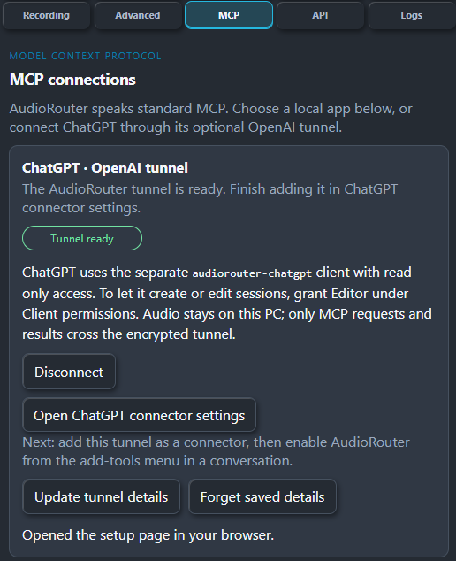
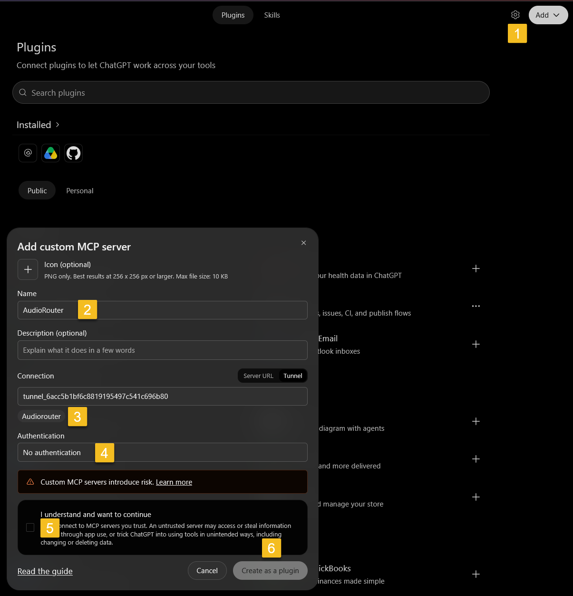
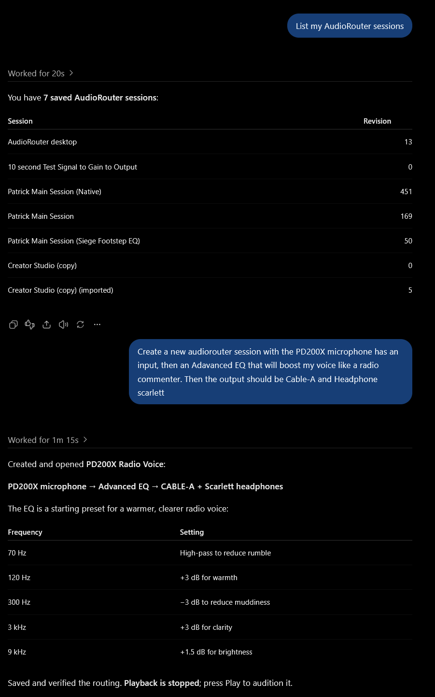
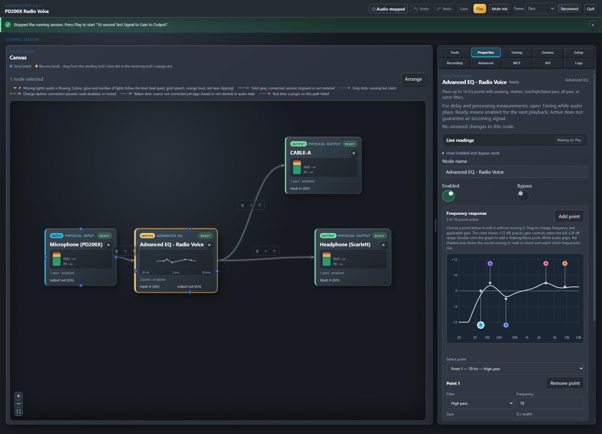

# ChatGPT MCP example: build a radio voice session

This example was run by the owner on Windows with AudioRouter 0.0.15 on
2026-10-12. The supplied screenshots show connection setup, a successful
session read and a new voice route created through the ChatGPT MCP plugin,
then displayed in AudioRouter.

## Before starting

Have an existing OpenAI tunnel and restricted runtime key configured using
the [ChatGPT tunnel setup](headless-runbook.md#chatgpt-secure-mcp-tunnel).
The default Observer permission
allows reading sessions. Creating or editing a session requires the owner to
grant **Editor** to `audiorouter-chatgpt` in AudioRouter's MCP Client permissions.

The PD200X microphone, CABLE-A output and Scarlett headphones in this example
are devices on the owner's PC. Use the names of your own devices in a request;
the assistant should ask when a device name is ambiguous.

## 1. Connect in AudioRouter

Open AudioRouter's **MCP** tab and connect the saved tunnel. Wait for
**Tunnel ready**, then choose **Open ChatGPT connector settings**. Keep
AudioRouter and its tunnel connected while adding or using the plugin.



*The owner's AudioRouter connection screen (`Mcp_AudioRouter_Setup.png`).*

## 2. Add the plugin in ChatGPT

The numbered markers in the next screenshot correspond to these steps:

1. Open **Plugins**, choose **Add**, then **Add custom MCP server**.
2. Enter a name such as **AudioRouter**.
3. Under **Connection**, choose **Tunnel** and select your existing AudioRouter
   tunnel. Use the same tunnel configured in AudioRouter.
4. Choose **No authentication** for AudioRouter's local stdio MCP server. The
   restricted runtime key belongs in AudioRouter's secure tunnel settings.
5. Review the tools warning and check **I understand and want to continue**.
6. Choose **Create as a plugin**.



*The owner's numbered ChatGPT setup example (`Mcp_ChatGPTPlugin.png`). The
tunnel ID shown is this example's ID; select your own configured tunnel.*

Install the resulting plugin from its plugin page and enable it in the
ChatGPT conversation before sending the requests below.

## 3. List the saved sessions

Ask the connected plugin:

```text
List my AudioRouter sessions
```

ChatGPT returns the saved session names and revisions. In the screenshot it
lists seven existing sessions before the new voice session is created.

## 4. Create a voice route

The owner then requested a PD200X input, Advanced EQ for a radio commentator
voice, and two destinations. A cleaned-up version of that request is:

```text
Create a new AudioRouter session with the PD200X microphone as the input.
Add Advanced EQ for a radio commentator voice, then send the result to
CABLE-A and the Scarlett headphones.
```

ChatGPT reports that it created and opened **PD200X Radio Voice**. The response
describes a starting EQ preset: a 70 Hz high-pass, +3 dB at 120 Hz, −3 dB at
300 Hz, +3 dB at 3 kHz and +1.5 dB at 9 kHz. These are the settings used in
this example, not a measured correction for every microphone or voice.



*The owner's ChatGPT request and response (`Mcp_Result.png`).*

## 5. Inspect the result in AudioRouter

The second screenshot shows **PD200X Radio Voice** open in AudioRouter. The
Microphone (PD200X) node feeds **Advanced EQ - Radio Voice**, which branches
to **CABLE-A** and **Headphone (Scarlett)**. The Properties panel displays the
five-point EQ curve.



*The resulting session in AudioRouter (`Mcp_Result2.png`).*

Playback is **stopped** in both the ChatGPT response and the app screenshot.
Review the chosen devices and route before pressing **Play** to audition it.
These screenshots demonstrate configuration through MCP; they do not qualify
audio quality, latency, denied permissions or credential revocation.
